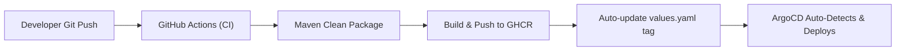

# Platform Engineer Roadmap: Spring Boot, Kubernetes, Helm & AWS

This project is a hands-on, step-by-step roadmap designed for transitioning from a **Senior Java Developer** with AWS certification into a **Platform Engineer**.

---

## 📖 Core Concepts Explained (Quick Reference)

- **Helm Chart:** A package manager for Kubernetes. Instead of writing separate, hardcoded YAML files for each environment, Helm lets you define reusable templates and pass configuration values dynamically via `values.yaml`.
- **Deployment:** A Kubernetes controller that declares how many copies (replicas) of your application should run, how rolling updates are performed, and automatically replaces failed pods.
- **Service (NodePort / ClusterIP):** An internal load balancer and stable network endpoint in front of your pods, ensuring traffic still reaches the app even when pod IP addresses change.
- **ConfigMap:** A Kubernetes object used to store non-sensitive configuration outside the container image, following 12-factor principles.
- **Liveness Probe:** A periodic check asking: *"Is the container still healthy?"* If the application deadlocks or stops responding, Kubernetes terminates and restarts the container.
- **Readiness Probe:** A periodic check asking: *"Is the application ready to serve traffic?"* During boot-up or dependency outage, Kubernetes halts routing traffic to that pod without restarting it.
- **Resource Requests & Limits:** Boundaries defining minimum reserved resources (*Requests*) and maximum ceiling (*Limits*) to prevent node starvation.
- **Graceful Shutdown:** Allowing in-flight HTTP requests and resources to finish cleanly when receiving a `SIGTERM` signal before stopping.
- **GitOps & ArgoCD:** A declarative continuous delivery model where **Git is the single source of truth**. ArgoCD continuously reconciles the live Kubernetes cluster state with the desired state declared in Git, automatically detecting and healing configuration drift.

---

## 🗺️ Overall Roadmap

```text
[Phase 1: Production-Ready Application in K8s (Completed)]
   ├── Spring Boot Actuator (Liveness & Readiness Probes)
   ├── ConfigMap & Environment Variables (12-Factor App)
   ├── Resource Requests & Limits (Prevent OOMKilled)
   └── Graceful Shutdown (Zero-downtime Rollout)

[Phase 2: GitOps with ArgoCD (Completed)]
   ├── ArgoCD Controller & Server deployment
   ├── Declarative Application CRD (argocd-application.yaml)
   └── Automated Sync & Self-Healing

[Phase 3: Automated CI/CD Pipeline with GitHub Actions (Completed)]
   ├── Maven build & test on every commit
   ├── Automatic Docker build & push to GitHub Container Registry (GHCR)
   └── Automated Helm values.yaml image tag update (GitOps Trigger)

[Phase 4: Observability & Ingress (Next Step)]
   ├── Kubernetes Ingress Controller (Nginx / Routing)
   ├── Prometheus & Metrics (JVM metrics via Micrometer)
   └── Grafana Dashboards

[Phase 5: Cloud Infrastructure on AWS]
   ├── Terraform (Provisioning VPC & EKS Cluster)
   ├── AWS IAM Roles for Service Accounts (IRSA)
   └── External Secrets Operator (AWS Secrets Manager)
```

---

## 🚀 Phase 2: GitOps with ArgoCD (Completed)

ArgoCD is now running inside the Minikube cluster under the `argocd` namespace.

### ❓ What Does ArgoCD Do & Why Do We Need It?

#### 1. What ArgoCD Does:
- **Continuous Reconciliation (Sync):** ArgoCD constantly monitors your Git repository (Helm charts/YAMLs) and compares it with what is actually running in the Kubernetes cluster.
- **Automated Deployment:** When you commit and push a change to Git (e.g., updating `image.tag: 1.8.0` or changing `replicaCount`), ArgoCD detects the difference and applies it to the cluster automatically.
- **Self-Healing:** If someone accidentally modifies or deletes resources directly in the cluster (via `kubectl` or a dashboard), ArgoCD detects this **Configuration Drift** and automatically restores the cluster back to the state defined in Git.
- **Visual Dashboard:** Provides a clear visual dependency tree of all resources (Applications, Deployments, Pods, Services, ConfigMaps) with real-time health and sync status.

#### 2. Why We Need It (Traditional CI/CD vs. GitOps):
- **No Direct Cluster Access Needed:** In traditional CI/CD, external pipelines (Jenkins, GitHub Actions) need sensitive admin `kubeconfig` credentials with write access to push changes into the cluster. With ArgoCD, the operator runs **inside** the cluster and pulls changes securely.
- **Git as Single Source of Truth:** Every deployment, rollback, and config change is tracked in Git history with full auditability (who changed what and when via PR reviews).
- **One-Click Instant Rollbacks:** Rolling back a bad release is as simple as reverting a git commit (`git revert`) or clicking "Rollback" in the ArgoCD UI.
- **Prevents Human Errors & Drift:** Eliminates inconsistencies between environments (Dev, Staging, Prod) by ensuring the cluster always strictly mirrors Git.

### How to Access the ArgoCD Web UI

1. Start port-forwarding the ArgoCD server:
   ```bash
   kubectl port-forward svc/argocd-server -n argocd 8085:443
   ```
2. Open your browser at:  
   **[https://localhost:8085](https://localhost:8085)** *(Accept the self-signed TLS warning)*
3. Login credentials:
   - **Username:** `admin`
   - **Password:** Retrieve dynamically with:
     ```bash
     kubectl -n argocd get secret argocd-initial-admin-secret -o jsonpath="{.data.password}" | base64 -d && echo ""
     ```

### Managing the App via GitOps (`argocd-application.yaml`)

An ArgoCD custom resource manifest [`argocd-application.yaml`](file:///Users/hadi/samples/SpringAppK8S/argocd-application.yaml) has been added to the project:
```yaml
apiVersion: argoproj.io/v1alpha1
kind: Application
metadata:
  name: spring-boot-app
  namespace: argocd
spec:
  project: default
  source:
    repoURL: 'https://github.com/YOUR_USERNAME/SpringAppK8S.git'
    targetRevision: HEAD
    path: helm/spring-app
    helm:
      valueFiles:
        - values.yaml
  destination:
    server: 'https://kubernetes.default.svc'
    namespace: default
  syncPolicy:
    automated:
      prune: true
      selfHeal: true
```

When you push this repository to Git and apply this file (`kubectl apply -f argocd-application.yaml`):
- ArgoCD takes over lifecycle management of the Helm chart.
- Any manual change in the cluster that doesn't match Git is automatically corrected (**Self-Healing**).
- Any commit merged to your branch is automatically rolled out to the cluster without developer intervention.

### 💡 Practical ArgoCD Tips for Platform Engineers

1. **How Rollbacks Work in ArgoCD:**
   - **Via UI:** Go to App > **History and Rollback** > Pick a previous revision > **Rollback**.  
     *Note:* ArgoCD automatically pauses `Auto-Sync` to avoid Git overriding your rollback immediately.
   - **The Best Practice (Git-Driven Rollback):** Run `git revert HEAD && git push`. Git remains the single source of truth, Auto-Sync stays active, and the rollback has an audit trail.

2. **Self-Healing vs. Emergency Hotfixes:**
   - With `selfHeal: true`, any manual change via `kubectl edit` is immediately overwritten by ArgoCD within seconds.
   - If you need to make an emergency temporary fix in the cluster, either disable auto-sync temporarily in the UI or update Git directly.

3. **Prune (`prune: true`):**
   - By default, Kubernetes will not delete old resources if they are removed from your Helm chart. Setting `prune: true` tells ArgoCD to clean up and delete orphaned Kubernetes resources when they are deleted from Git.

4. **Polling vs. Webhooks (Speeding up Sync):**
   - By default, ArgoCD polls Git every **3 minutes** to look for changes.
   - In production, configure a **GitHub Webhook** pointing to `https://<argocd-url>/api/webhook`. This triggers instant zero-delay syncs the millisecond code is pushed.

5. **Hard Refresh when Stuck:**
   - If you pushed changes to Git but ArgoCD hasn't reflected them yet, click **Refresh** (or drop-down **Hard Refresh**) in the UI, or run:
     ```bash
     kubectl patch application spring-boot-app -n argocd --type merge -p '{"metadata": {"annotations": {"argocd.argoproj.io/refresh": "hard"}}}'
     ```

6. **Separate App Code from Infrastructure/Config Repos:**
   - In real-world enterprise architectures, avoid keeping application code and Helm manifests in the same repo.
   - **Pattern:** Keep the Java code in `spring-app-repo` (with CI producing Docker images), and keep Helm/K8s manifests in a dedicated `spring-app-gitops` repo. This avoids recursive CI build loops when updating image tags.

---

## ⚙️ Phase 3: Automated CI/CD Pipeline (GitHub Actions)

We automated the entire build-test-deploy loop via [`.github/workflows/ci.yaml`](file:///Users/hadi/samples/SpringAppK8S/.github/workflows/ci.yaml):



### How the Pipeline Works:
1. **Trigger:** Fires on any push to the `main` branch (ignoring changes in `helm/**` and markdown to avoid infinite build loops).
2. **Build:** Sets up JDK 21 and builds an executable JAR using Maven.
3. **Publish Image:** Authenticates against **GitHub Container Registry (`ghcr.io`)** using the built-in `GITHUB_TOKEN` and publishes an image tagged with the short commit SHA (`sha-xxxxxxx`) and `latest`.
4. **GitOps Handoff:** Automatically modifies `helm/spring-app/values.yaml` with the new image tag and commits it back with `[skip ci]`.
5. **ArgoCD Sync:** ArgoCD detects the new tag in Git and rolls out the new version to Kubernetes with zero downtime.

---

## 📁 Project Structure

```text
SpringAppK8S/
├── .github/workflows/ci.yaml                # Automated GitHub Actions CI pipeline
├── pom.xml                                  # Spring Boot dependencies + Actuator
├── Dockerfile                               # Temurin Alpine JRE 21 image
├── argocd-application.yaml                  # Declarative ArgoCD GitOps Application manifest
├── src/main/
│   ├── java/com/example/demo/
│   │   └── Application.java                 # Spring Boot app with REST endpoint & @Value injection
│   └── resources/
│       └── application.properties           # Probes, shutdown timeout & env variable fallback
└── helm/
    └── spring-app/                          # Helm Chart
        ├── Chart.yaml                       # Chart metadata
        ├── values.yaml                      # Configurable values (replicas, image, resources, probes)
        └── templates/
            ├── deployment.yaml              # Deployment manifest with probes, limits, and env injection
            ├── configmap.yaml               # ConfigMap template for environment variables
            ├── service.yaml                 # Internal ClusterIP Service
            └── ingress.yaml                 # Layer 7 HTTP Routing & Host-based Ingress
```

---

## 🛠️ Step-by-Step CLI Execution Guide

### 1. Build and Run App Locally in Minikube
```bash
mvn clean package -DskipTests
minikube image build -t spring-app-k8s:1.1.0 .
helm upgrade --install my-spring-app ./helm/spring-app
```

### 2. Verify Status & Health Probes
```bash
kubectl get pods,svc,configmap -l app=spring-app
kubectl exec deploy/my-spring-app-deployment -- wget -qO- http://localhost:8080/actuator/health
```

### 3. Check ArgoCD Status
```bash
kubectl get pods -n argocd
```

---

## 💡 Key Helm & ArgoCD Commands

| Command | Purpose |
| :--- | :--- |
| `helm list` | List installed Helm releases |
| `helm upgrade my-spring-app ./helm/spring-app` | Upgrade release locally |
| `kubectl port-forward svc/argocd-server -n argocd 8085:443` | Access ArgoCD UI locally |
| `kubectl apply -f argocd-application.yaml` | Register GitOps app in ArgoCD |
